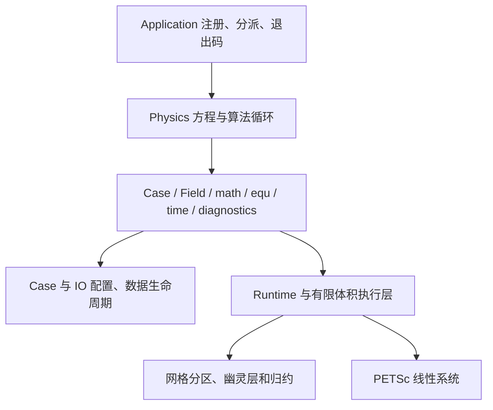

# 01 架构与维护边界

[开发指南](README.md) · 下一章：[公开 C++ 接口](public-api.md)

## 分层

| 层 | 源码入口 | 职责 |
| --- | --- | --- |
| 应用 | [application.h](../../include/babelsim/application.h)、[application.cpp](../../src/runtime/application.cpp) | 求解器注册、MPI 会话与状态映射 |
| 算例/IO | [case.h](../../include/babelsim/case.h)、[src/io](../../src/io/) | 解析配置、拥有网格/命名场、输入输出 |
| 场与几何 | [field.h](../../include/babelsim/field.h)、[geometry.h](../../include/babelsim/geometry.h) | 场类型、位置、边界和值操作 |
| 配置 | [config.h](../../include/babelsim/config.h)、[methods.h](../../include/babelsim/methods.h) | 类型化读取、使用追踪、命名离散配置 |
| 数学与方程 | [math.h](../../include/babelsim/math.h)、[equ.h](../../include/babelsim/equ.h) | 显式已知场运算、过程式未知量装配 |
| 时间/观测 | [time.h](../../include/babelsim/time.h)、[history.h](../../include/babelsim/history.h)、[monitor.h](../../include/babelsim/monitor.h) | 显式时间、历史和报告 |
| 内部执行 | [src/runtime](../../src/runtime/)、[src/internal](../../src/internal/)、[src/discretization](../../src/discretization/) | 活动运行域、离散工作区、执行与同步 |
| 线性后端 | [src/backend](../../src/backend/) | PETSc 句柄、模式、数值更新、真实残差与 PC 复用 |
| 并行 | [src/parallel](../../src/parallel/) | MPI、图划分、halo、owned 输出 |
| 物理算法 | [src/physics](../../src/physics/) | 五个正式求解器及 RANS 模型 |

## 公开接口的边界

Physics 和外部求解器使用 `include/babelsim`。它们不访问 `src/internal`、PETSc/MPI/Eigen 头、CSR 布局、Field 原始数组或另一求解器的私有实现。同步、分区及稀疏格式由内部执行层处理。外部源文件可用普通 g++ 只加 `-Iinclude` 编译，链接阶段使用匹配的 MPI 与 PETSc 库。

算例字典由 Case/IO 解析，公开 math/equ 接收已解析的 `OperatorOptions` / `EquationControl`。不要在后端热路径中重新读字典，也不要通过后端优化改变 Physics 的数学语义。

## 所有权与生命周期

Case 拥有 Mesh 和命名场；返回的场引用在 Case 生命周期内稳定。`problem.load`、`problem.create`、`problem.fields` 分别负责加载、创建、查找，统一返回场引用；修正场也通过 `problem.create.homogeneousCorrection` 创建并由 Case 管理。不能用同名 create 重复初始化已存在场。配置访问集中在 `problem.read`。Equation 绑定确定的未知场并拥有独立装配状态；History 持有显式场快照。

初始化按依赖排列：读取强类型配置 → 加载/创建场 → 从描述绑定方程 → 计算物理初值并构造模型 → 登记历史和回滚状态 → `problem.finalizeInitialization()` → 主循环。该入口检查配置消费、描述要求的场及方程绑定、类型/位置、初始化来源和边界能力，成功后关闭资源声明。它不推进时间或求解；`time::makeStepper(problem)` 只构造时钟，之后显式 `advance()`。

Equation、History 和临时 Field 应在其 Case/网格仍有效时销毁。程序不管理 PETSc 句柄或手工 MPI 会话。当前活动运行域不适合作为任意多个独立 Case 同线程重叠求解的通用调度器；多算例批处理使用独立进程或顺序生命周期。

## 线性系统生命周期

每个长期存在的方程使用对应后端线性系统。第一次需要时建立稀疏模式，随后根据装配更新矩阵和 RHS，支持矩阵不变时仅更新 RHS。Equation 在循环外创建、在循环内 reset，便于保留布局与分配。

预条件器可以跨矩阵版本复用，矩阵 A 仍是当前版本；求解后验证当前 A 的真实残差。周期、累积工作、迭代增长和失败重试控制复用预算。PETSc 的 Mat/Vec/KSP/PC 类型只存在于 backend/internal 层。Eigen 用于局部最小二乘，不作为第二套生产稀疏后端。

## 算法职责

SIMPLE、transientSimple、PISO 分别拥有自己的循环和接受判断。Rhie–Chow、压力校正与流动特有步骤留在对应 Physics 中。RANS 模型分别管理输运量、历史和闭合，通过模型接口向流动算法提供有效黏度等信息。

Runtime 不猜 PDE、不判断工程物理收敛、不打印具体算法进度。diagnostics 只观察，monitor 只报告；收敛布尔值与结构化 SolverResult 由 Physics 明确计算。字段选择与 write 只负责输出，不代表物理任务完成。

## 维护要求

修改公开接口时检查所有正式求解器、RANS 和外部示例；修改离散或后端时保持积分量、方向和冻结装配契约；修改并行时检查 owned/ghost、跨分区面和全局归约。`make test-architecture` 按实际 include 闭包检查这些边界，详细测试矩阵见[验证指南](verification.md)。

维护底层实现时，参见[框架源码阅读与修改](framework-maintenance.md)，其中给出了装配到 PETSc 的调用链、MPI 分发与 halo 的职责，以及积分系数和冻结通量的约定。
