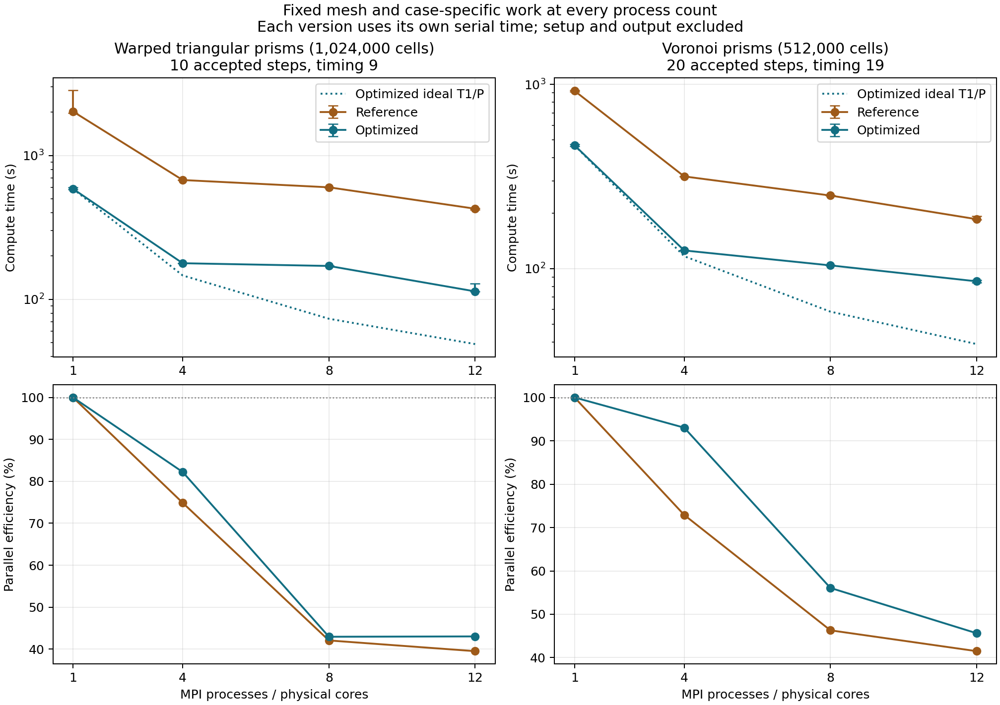
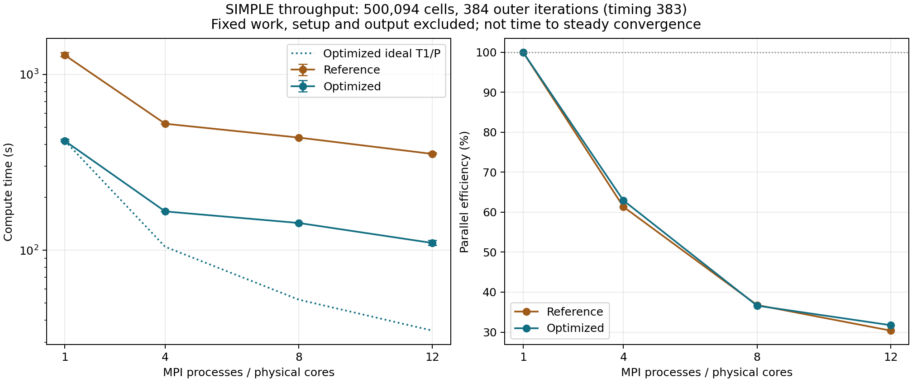
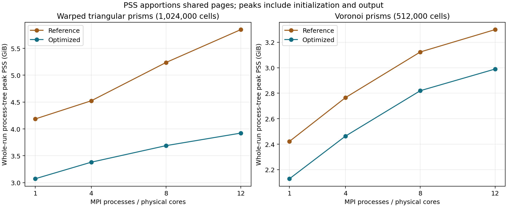

# BabelSim 通用计算速度与强扩展优化：2026-10-07—08

## 工程规模结果

畸变三棱柱的 12 进程计算时间为 113.60 秒，相对优化版本自身的单进程加速 5.16 倍、效率 43.0%；相同 12 进程下比参考后端快 3.76 倍。 非结构 Voronoi 棱柱的 12 进程计算时间为 85.27 秒，相对优化版本自身的单进程加速 5.47 倍、效率 45.6%；相同 12 进程下比参考后端快 2.17 倍。
本轮完成后端、网格分发/划分、字段访问的通用优化及验证。
数据是固定网格和物理工作量的强扩展测量，适用于下面列明的单机环境；效率没有达到理想线性扩展。

| 网格 | MPI 进程 | 样本数 | 计算时间中位数 / s | 同版加速比 | 同版并行效率 | 全程峰值 PSS / GiB |
|---|---:|---:|---:|---:|---:|---:|
| 畸变三棱柱 | 1 | 3 | 586.52 | 1.00× | 100.0% | 3.07 |
| 畸变三棱柱 | 4 | 1 | 178.33 | 3.29× | 82.2% | 3.38 |
| 畸变三棱柱 | 8 | 1 | 170.73 | 3.44× | 42.9% | 3.69 |
| 畸变三棱柱 | 12 | 3 | 113.60 | 5.16× | 43.0% | 3.92 |
| 非结构 Voronoi 棱柱 | 1 | 3 | 466.82 | 1.00× | 100.0% | 2.13 |
| 非结构 Voronoi 棱柱 | 4 | 1 | 125.44 | 3.72× | 93.0% | 2.46 |
| 非结构 Voronoi 棱柱 | 8 | 1 | 104.07 | 4.49× | 56.1% | 2.82 |
| 非结构 Voronoi 棱柱 | 12 | 3 | 85.27 | 5.47× | 45.6% | 2.99 |

两种版本都在 1、4、8、12 个 MPI 进程下使用完全相同的算例输入。
单进程和 12 进程各有三份独立样本，4、8 进程各有一份持续样本；
效率分子使用同一版本三份单进程样本的中位数。误差条只表示观测最短到最长，不是置信区间。
研究中临时目录被清空、原进程停止。两种二进制与全部输入恢复后逐文件校验通过；
参考版重建后的可执行文件与原文件哈希完全一致。
畸变三棱柱主曲线选择恢复后的全部 8 个测点，其中 6 个测点为补算丢失字段时重新测得，
另 2 个为续跑完成；选择依据是运行时期和字段可用性，不按速度挑选。
Voronoi 的 10 步补算在优化后 12 进程上只得到 55.395 秒窗口，因此整条曲线的两个版本、
所有进程数都改为 20 步重新测量；原 10 步数据完整保留，不混入最终 20 步曲线。
重启前测点独立保留，恢复运行见[恢复记录](flow-optimization-2026-10-07-evidence/recovery-2026-10-08.json)。
精确数值、工作量、分区、内存和完整回调阶段计数见
[审计汇总](flow-optimization-2026-10-07-evidence/strong-summary.json)与[CSV](flow-optimization-2026-10-07-evidence/strong-scaling.csv)。

## 目标、算例与测量契约

目标是在当前抽象层次和物理语义下同时改善计算速度、强扩展和内存利用。
强扩展保持网格与物理工作量不变，定义 `S(P)=T(1)/T(P)`、`E(P)=S(P)/P`。
每个版本使用它自己的单进程时间。更慢的历史串行版本不进入新版效率的分子。

选择两种合法且已作实际几何检查的工程规模网格，覆盖面数规则与面数变化两类稀疏连接：

| 算例 | 单元数 | 面数 | 每单元面数 | 几何与边界 |
|---|---:|---:|---:|---|
| 畸变三棱柱 | 1,024,000 | 2,585,600 | 5 | `n=80`、warp=0.15 的三棱柱；入口、出口、壁面、对称边界 |
| 非结构 Voronoi 棱柱 | 512,000 | 2,064,032 | 5—15 | 有界 Voronoi 截面挤出；相同流动边界和数值控制 |

两者使用已有 PISO 流动求解器、隐式 Euler、`dt=0.01`。
畸变三棱柱接受 10 步至 `t=0.1`，Voronoi 接受 20 步至 `t=0.2`；各自工作量在所有版本和进程数上固定。
压力和动量相对线性容差均为 `1e-8`，绝对容差分别为 `1e-13`、`1e-12`；
保留压力速度耦合要求及最多 100 次修正。要求每一步接受、耦合收敛且线性检查正常。
算例输入生成器与网格/输入哈希见[输入清单](flow-optimization-2026-10-07-evidence/strong-case-inputs-10.json)、
[20 步 Voronoi 输入](flow-optimization-2026-10-07-evidence/voronoi20-input.json)、
[几何检查](flow-optimization-2026-10-07-evidence/prism80-geometry.json)及[Voronoi 几何检查](flow-optimization-2026-10-07-evidence/voronoi-geometry.json)。
它们测量实际压力速度耦合流程，不以重复独立 SpMV 代替求解。

- 硬件：AMD Ryzen AI MAX+ 392，12 个物理核、24 个逻辑线程，单 NUMA，32 MiB L3；WSL2 RAM 约 7.6 GiB、swap 2 GiB。
- 软件：PETSc 3.25.5、Hypre 3.1.0、OpenMPI 4.1.2、METIS 5.1.0、GCC 11。
- 每个 rank 单线程并绑定物理核。二进制采用相同编译优化，保持 NaN/Inf 检查，关闭浮点融合乘加。
- 所有数值任务逐项运行；计时期间没有另一项测试、编译、网格生成、模型研究或大型字段比较/绘图。
- `T(P)=max_rank(iterationComputeSeconds)`：首次完整迭代结束后才计时，
  畸变三棱柱计量后 9 个接受步，Voronoi 计量后 19 个接受步。
  排除 mesh 读取/对象创建、字段/方程创建、首次稀疏模式和首次 PC 准备、整个首步，扣除窗口内输出。
- 每个正式样本的有效计算窗口均超过 60 秒；固定工作量要求下，串行及部分参考版本会超过 3 分钟。
  校准、诊断与短样本保留在独立目录，不混入正式强扩展统计。

进程树 RSS 每 0.1 秒采样，PSS 每秒采样。RSS 会重复累计共享页，PSS 按比例分摊；
报告的峰值涵盖完整进程生命周期，包括初始化和输出，不能称为计算窗口内峰值。
多样本峰值取中位数，VmSwap 单独记录。宿主 Windows 的活动和动态频率未被完全控制，
单样本点不能判定几个百分点的差异稳定存在。

用户要求先保存远端检查点时，提交 `78b712ef24704d14fc64cbcba3b4f9f7cbd2c438` 并正常推送到
`refs/heads/codex/polyhedral-fvm`，随后以 `git ls-remote` 核对远端与本地 HEAD 一致。
该 Git 操作与 Voronoi 20 步参考版本的首次单进程样本重叠，Git 绑定逻辑 CPU 2，
打包线程数为 1；求解二进制和输入没有变化。保留该样本，并使用预先安排的串行与
12 进程重复样本统计，不将它描述为宿主完全空闲的测量。
见[检查点与宿主活动记录](flow-optimization-2026-10-07-evidence/checkpoint-git-push.json)。

## 相同进程数的版本收益

参考版本已包含之前的矩阵/PC 复用、内存和规范化 METIS 划分优化；它不是最初 Git HEAD。
这一对照主要评价新的 CPU AMG 层级与松弛策略，以及字段访问优化。
前后保持 `pcType hypre`、Krylov 类型和精度要求；层级策略改变了每次 V-cycle 的成本和迭代次数。
这属于通用后端的算法配置优化，不能解读为稀疏乘法本身获得了同样倍数的加速。

| 网格 / MPI 进程 | 参考 / s | 优化后 / s | 同进程数版本加速 | 参考同版效率 | 优化后同版效率 |
|---|---:|---:|---:|---:|---:|
| 畸变三棱柱 / 1 | 2023.31 | 586.52 | 3.45× | 100.0% | 100.0% |
| 畸变三棱柱 / 4 | 675.54 | 178.33 | 3.79× | 74.9% | 82.2% |
| 畸变三棱柱 / 8 | 601.25 | 170.73 | 3.52× | 42.1% | 42.9% |
| 畸变三棱柱 / 12 | 426.79 | 113.60 | 3.76× | 39.5% | 43.0% |
| 非结构 Voronoi 棱柱 / 1 | 923.24 | 466.82 | 1.98× | 100.0% | 100.0% |
| 非结构 Voronoi 棱柱 / 4 | 316.58 | 125.44 | 2.52× | 72.9% | 93.0% |
| 非结构 Voronoi 棱柱 / 8 | 249.28 | 104.07 | 2.40× | 46.3% | 56.1% |
| 非结构 Voronoi 棱柱 / 12 | 185.44 | 85.27 | 2.17× | 41.5% | 45.6% |

| 网格 / 版本 | MPI 进程 | 样本数 | 最短 / s | 中位数 / s | 最长 / s | 全程进程交换页峰值 / MiB |
|---|---:|---:|---:|---:|---:|---:|
| 畸变三棱柱 / reference | 1 | 3 | 1967.58 | 2023.31 | 2837.82 | 0.0 |
| 畸变三棱柱 / reference | 12 | 3 | 421.32 | 426.79 | 431.65 | 0.0 |
| 畸变三棱柱 / optimized | 1 | 3 | 579.50 | 586.52 | 601.96 | 0.0 |
| 畸变三棱柱 / optimized | 12 | 3 | 113.31 | 113.60 | 129.22 | 0.0 |
| 非结构 Voronoi 棱柱 / reference | 1 | 3 | 912.37 | 923.24 | 928.61 | 0.0 |
| 非结构 Voronoi 棱柱 / reference | 12 | 3 | 184.68 | 185.44 | 192.05 | 0.0 |
| 非结构 Voronoi 棱柱 / optimized | 1 | 3 | 460.54 | 466.82 | 472.66 | 0.0 |
| 非结构 Voronoi 棱柱 / optimized | 12 | 3 | 83.70 | 85.27 | 86.41 | 0.0 |

完整的同进程数对照见[对照 CSV](flow-optimization-2026-10-07-evidence/strong-comparison.csv)。

## SIMPLE 的工程规模持续吞吐与强扩展

最终同一二进制另在 500,094 单元、1,266,111 面的畸变三棱柱网格上执行 384 次生产 SIMPLE 外迭代，
计量后 383 个完整间隔。除了外迭代上限从 128 增至 384，输入保持先前吞吐实验的配置；
两个版本、各进程数的输入完全相同，保持既有离散、松弛和线性精度要求。
较严的外层容差使其达到迭代上限，预期退出状态为 `maxIterations`。
验收同时要求生产 CLI 的预期退出码 2、全部 rank 的 383 个计量间隔，以及正常线性检查；
完成日志或性能报告不能使异常退出成为有效样本。退出判定核对见
[验收检查](flow-optimization-2026-10-07-evidence/benchmark-exit-contract-audit.json)。
这是一项持续吞吐实验，**不能解释为达到物理稳态收敛的时间**。
生产 SIMPLE 在未收敛时不输出最终场，因此此处以线性检查、完整工作量和独立收敛回归验证它的运行。

| MPI 进程 | 样本数 | 计算中位数 / s | 同版加速比 | 同版并行效率 | 同进程数版本加速 |
|---:|---:|---:|---:|---:|---:|
| 1 | 3 | 418.51 | 1.00× | 100.0% | 3.07× |
| 4 | 1 | 166.24 | 2.52× | 62.9% | 3.15× |
| 8 | 1 | 142.87 | 2.93× | 36.6% | 3.06× |
| 12 | 3 | 109.92 | 3.81× | 31.7% | 3.21× |

SIMPLE 的加速比与效率同样使用它自身、同版本、同输入的单进程时间。
它的工作单位与 PISO 接受步不同，不能直接比较两表耗时来评价两个算法优劣。
单进程和 12 进程各三份样本，4、8 进程各一份；每个正式样本的有效计算窗口均超过 60 秒。
输入见[吞吐输入清单](flow-optimization-2026-10-07-evidence/simple-throughput-input.json)，原始数据见
[SIMPLE 研究](flow-optimization-2026-10-07-evidence/simple-strong-scaling/study.json)、[汇总](flow-optimization-2026-10-07-evidence/simple-summary.json)
和[CSV](flow-optimization-2026-10-07-evidence/simple-scaling.csv)。达到稳态收敛的 SIMPLE 全字段一致性另由完整回归证明。

## 通用实现与抽象

Physics 源码没有改动。物理程序继续通过现有 `equ`、`math`、场和 Case 接口组织计算；
框架没有按算例名称、场名、网格类别或特定 MPI 进程数分支。

1. 每个方程保留 PETSc Mat、KSP、PC 与工作空间；精确比较装配数值，任一 rank 有变化就共同更新 A，
   完全不变时只更新 RHS。冷启动利用 `r0=b` 省去冗余 SpMV；warm start 仍测量 `b-Ax0`。
2. PC 的矩阵版本与非零迭代 RHS 工作预算均默认为 8；迭代增长请求提前重建，旧 PC 失败后
   用原始初值、当前 A 和原残差目标重建重试一次。Block Jacobi 局部因子准备显式计入 setup。
3. CPU Hypre 默认 HMIS、ext+i、插值每行至多 4 项。CG/GMRES/FGMRES 用 1 层激进粗化，
   串行保留 CF 顺序，MPI 用自然顺序。BiCGStab 保留常规粗化及 CF 顺序，避免已验证扩散矩阵的 breakdown。
   保持对称 SOR/Jacobi 平滑、一次 V-cycle、零 PC 内部容差和最终 `b-Ax` 检查。
   高级设置使用临时私有 PETSc options 数据库，并在销毁前恢复旧数据库；全局选项不被改写。
4. COO 行列只在建立稀疏模式时临时分配；长期计划只保存 upper/lower 面索引，owned 顺序引用 Mesh。
   矩阵数值快照交换缓冲避免整段复制；向量三个分量顺序共享 RHS/解 Vec 和工作数组，保留分量收敛记录。
5. 边界更新使用已有 patch 面列表，避免扫描全部内部面；两轮 Green–Gauss 梯度只快照单元梯度值，
   避免复制整个 Field、边界迹和附加元数据；连续写入先取得数组，减少反复 halo 失效标记。
   保留原有梯度重构、边界和完整 stencil 计算规则。
6. root 一次读取全局网格与计算所有权，逐 rank 分发 owned 和完整三层 halo 的面环、坐标和元数据；
   工作 rank 只构造局部 Mesh，root 与工作 rank 在局部几何构造前释放全局网格或传输缓冲。
   各阶段错误集体传递，保持全局 ID、面方向、物理 patch 及 owned 配额。

Hypre 官方推荐在 CPU 上使用 HMIS、扩展插值与受限插值行宽，并用激进粗化降低层级复杂度；
松弛顺序与 BiCGStab 例外来自本机实际测量和回归，而不是网格名称。
参见 [Hypre BoomerAMG 文档](https://hypre.readthedocs.io/en/stable/solvers-boomeramg.html)、
[PETSc 3.25.5 Hypre 实现](https://raw.githubusercontent.com/petsc/petsc/v3.25.5/src/ksp/pc/impls/hypre/impl/ihypre.c)、
[PETSc options 关联接口](https://petsc.org/release/manualpages/Sys/PetscObjectSetOptions/)。
用户控制与运行语义见[数值配置](../numerical-configuration.md)，计数边界见[性能方法](../performance/README.md)。

## 先建图模型，再接入框架

Python 模型比较 13 类由实际网格连接构成的图，包含立方体、薄板、长管道、旋转、障碍、分支、
局部加密、畸变棱柱、四面体、Voronoi、不连通域和编号打乱。
最终比较为 52 组问题、572 次顺序实验，工程规模约 14.7 万—51.2 万单元。
选择 `metis-volume-contig` 固定种子 0：三层 ghost 几何平均减少 23.6%，最差一组增加约 0.30%。
这是图指标，不能直接换算为求解器加速。

METIS 使用通信量目标与单元数/面关联数双约束，连通输入请求连续分区；
之后用割边代价优先队列、最多展开 64 节点的局部连通证明和路径搬移恢复精确 owned 配额。
没有 METIS 时保留确定性图生长实现；公开 SDK 不暴露 METIS 类型。
模型与 C++ 的 500,094 单元 CSR、权重和初始/修正后所有权逐单元完全对齐。
一次性配额比例除法单独禁用快速倒数变换，解决 `-ffast-math` 导致 METIS 输入末位不同的问题。
方法、修正后的图证据与官方资料见[划分研究报告](partition-model-2026-10-07.md)。

| 网格 / MPI 进程 | owned 单元最小—最大 | owned 面负载 max/mean | 全部局部面负载 max/mean | 三层 ghost 总数 | 最大邻接 rank 数 |
|---|---:|---:|---:|---:|---:|
| 畸变三棱柱 / 4 | 256000—256000 | 1.0002 | 1.0105 | 78,985 | 3 |
| 畸变三棱柱 / 8 | 128000—128000 | 1.0006 | 1.0380 | 149,172 | 5 |
| 畸变三棱柱 / 12 | 85333—85334 | 1.0013 | 1.0657 | 201,747 | 6 |
| 非结构 Voronoi 棱柱 / 4 | 128000—128000 | 1.0004 | 1.0046 | 58,152 | 3 |
| 非结构 Voronoi 棱柱 / 8 | 64000—64000 | 1.0053 | 1.0701 | 112,204 | 5 |
| 非结构 Voronoi 棱柱 / 12 | 42666—42667 | 1.0064 | 1.1059 | 153,334 | 6 |

owned 面与含 halo 的全部局部面是不同负载指标；owned 单元精确平衡并不意味着 ghost 开销完全平衡。
分区没有缩减 halo 层数。内存证据如下：

早期 500,094 单元内存对照在独立[旧阶段证据](flow-optimization-2026-10-07-evidence/memory-partition-ab/records.json)和
[规范化划分曲线](flow-optimization-2026-10-07-evidence/final-strong-scaling/records.json)中保留。
它们使用 SIMPLE 128 外迭代或 PISO 6 步，不能混入当前 PISO 10/20 步的强扩展。
其中旧存储策略的 12 进程运行触发了真实交换页压力，分发/存储改进消除了相应新版本的交换页峰值。
早期受游戏活动影响的样本、末位比例未修正的划分版本及不满 60 秒的 AMG 筛选均有独立记录，
不进入当前正式汇总。

## 数值验证与剩余限制

最终版本通过完整 `make -j4 test-full`；分组顺序执行。
覆盖 78 源文件/头文件的层次与循环依赖检查、标量/向量方程、矩阵变化与 RHS-only、
PC 工作预算/增长/失败重试、全局 options 隔离及四种 Krylov 配置切换，
外部 SDK、几何和边界、Euler/BDF2 时间精度、RANS 拒绝路径、PISO 耦合、
收敛 SIMPLE 的串并行全字段、MPI 热传导和 Poiseuille。
MPI 数学回归覆盖 23 个操作、3 种扩散和 2 种梯度，并故意污染 halo；结果与串行一致。
完整日志见[最终回归](flow-optimization-2026-10-07-evidence/tests/test-full-amg-krylov-policy-cf.log)。

新 AMG 筛选曾在小型热传导 BiCGStab 上发生真实 breakdown；保留失败日志，并在通用后端
以 Krylov 类型选择常规粗化/CF 顺序后重新通过回归。没有改变热传导输入或放宽容差。
诊断专用 PCView observer 另有一次 MPI 集体参与错误，修复后通过 1/2/4 进程复测；
正式测量从未加载该诊断工具。细节见[热传导定位](flow-optimization-2026-10-07-evidence/heat-amg-regression)及
[诊断修复记录](flow-optimization-2026-10-07-evidence/tests/pc-view-diagnostic-fix.json)。

大型算例按 global ID 合并所有 owned 单元，验证 `U`、`p` 全局覆盖、无重复 ID、有限值、
字段类型、最终物理时间（三棱柱 `t=0.1`、Voronoi `t=0.2`）、几何坐标，
以及优化前后和优化版本自身不同进程数的一致性。
判定 `atol=rtol=5e-6`，表列实际最大差；所有几何坐标差不超过 `1e-11`。

| 网格 | 对照组数 | 全局单元数 | U 最大绝对差 | p 最大绝对差 |
|---|---:|---:|---:|---:|
| 畸变三棱柱 | 7 | 1,024,000 | 3.53e-08 | 1.7e-08 |
| 非结构 Voronoi 棱柱 | 7 | 512,000 | 1.11e-07 | 6.57e-08 |

逐对照结果与字段内容哈希见[字段比较](flow-optimization-2026-10-07-evidence/strong-field-comparisons.json)。
这证明本轮实现对所测流程的数值一致性；工程网格的 10/20 步运行不是长期流动物理精度、
网格独立性或时间步独立性的完整验证。

强扩展受局部计算、共享内存带宽、halo 和 AMG 各层通信共同限制。
`haloSeconds/globalReductionSeconds` 只覆盖 BabelSim 的显式通信，不包含 PETSc/Hypre 内部通信；
完整回调阶段时间含首步，不能与后 9/19 步窗口直接闭合，也不能把各 rank 阶段最大值相加。
先前 PETSc 诊断显示参考后端的 PCApply 占 KSPSolve 约 97%，因此先优化层级每次应用成本。
当前 v12 在 102.4 万单元、12 进程上另作独立 PETSc 剖析：PCApply 为 95.540 秒、
KSPSolve 为 128.22 秒（约 74.5%），CG 的 VecTDot 为 13.761 秒（约 10.7%）。
这些是包含首步的全程序事件计时，事件有嵌套，不能相加或用作正式计算时间。
见[当前剖析](flow-optimization-2026-10-07-evidence/amg-strong-profiles/v12-current-profile-summary.json)。
剖析初次命令遗漏 `-log_view` 文件名前的冒号，导致 PETSc finalize 出错；修正后独立重测成功，
初次失败剖析不进入任何正式样本。
串行基线曾在相同二进制、输入及压力迭代次数下出现明显耗时变化，故本轮也重复单进程，
保留全部样本范围。宿主活动或频率的具体贡献没有测定，不能凭一次慢串行样本宣称效率提高。
优化后残余瓶颈须按当前阶段计时和独立剖析判断，不能承诺继续增加进程就线性提速。

针对当前内积开销另作三组交错持续对照，使用 PETSc 公共接口合并分布式 CG 的两个内积归约，
保留相同预条件、非预条件残差范数、容差和最终真实残差检查；两种版本每份样本均接受同样 10 步。
配对加速几何平均为 0.8001 倍，
三次配对范围为 0.6375—0.9067 倍。
实际工程全字段对照均通过，额外内存为每个 CG 方程两个 owned 工作向量。
本轮选择：保留已通过完整回归的 v12；单归约在三组工程规模配对中平均慢 24.99%，没有支持接入的速度收益。
诊断使用独立 preload overlay，其源码/库/包装器/底层二进制哈希都保留，未与正式性能曲线混用。
见[三组对照](flow-optimization-2026-10-07-evidence/cg-single-reduction-screen-summary.json)、
[选择记录](flow-optimization-2026-10-07-evidence/cg-single-reduction-decision.json)和
[PETSc 归约接口](https://petsc.org/release/manualpages/KSP/KSPCGUseSingleReduction/)。

单机结果不直接外推到多节点互连、不同内存配置、强各向异性或其他难度的矩阵。

## 复现与版本

最终二进制 SHA256：`2114c30d7632f2fa500822cfafe2a134c69a5e280089bc312243ff3be2e7c53c`。
参考二进制 SHA256：`7a29412a574f912f6d67c7b3514b7aa15c60b854c222a455392ed977cb61a6b2`。
源码快照、补丁与构建/验证清单见[最终源码清单](flow-optimization-2026-10-07-evidence/final-source-amg/manifest.json)。
该回归快照保持原样；之后的测量恢复、输入延长、构建元数据解析修正及报告脚本由
[交付清单](flow-optimization-2026-10-07-evidence/delivery-source/manifest.json)单独记录。生产 C++ 与通过回归的快照逐文件匹配。
顶层流程、Case 参数解析、矩阵/PC 生命周期、真实残差与拓扑划分依据的源码核对见
[框架优化范围核对](flow-optimization-2026-10-07-evidence/framework-scope-review.md)。
交付审计从不同运行目录的原始测点重新计算中位数、范围、同版串行分母、加速比和效率，
并核对当前性能文件、研究的二进制/输入哈希，以及 14 组全字段比较涉及的导出文件内容哈希。
源码比较基线为 `83d7b72757f7f9af2db1a01a097389f86c296117`；
生成报告时本地分支为 `codex/polyhedral-fvm`，HEAD 为 `78b712ef24704d14fc64cbcba3b4f9f7cbd2c438`。
阶段提交及远端状态单独核对，不以源码快照或本地 HEAD 推断推送已完成。

正式命令和不可变输入哈希见[原研究元数据](flow-optimization-2026-10-07-evidence/amg-strong-scaling/study.json)、
[恢复后的三棱柱曲线](flow-optimization-2026-10-07-evidence/amg-strong-post-restart/study.json)、
[20 步 Voronoi 曲线](flow-optimization-2026-10-07-evidence/amg-voronoi20-strong-scaling/study.json)、
[字段恢复运行](flow-optimization-2026-10-07-evidence/strong-field-recovery/records.json)及
[三棱柱重复研究](flow-optimization-2026-10-07-evidence/amg-prism-repeat/study.json)、
[Voronoi 重复研究](flow-optimization-2026-10-07-evidence/amg-voronoi20-repeat/study.json)、
[SIMPLE 重复研究](flow-optimization-2026-10-07-evidence/simple-repeat/study.json)及[完整构建参数](flow-optimization-2026-10-07-evidence/recovered-build-recipe.json)。
驱动为 `tools/benchmark_solver_optimization.py`，带机器范围互斥锁、固定顺序随机种子、
输入/二进制哈希、完整日志、工作量校验和内存 trace。
完成数值运行后，依次运行本目录 `compare-flow-fields.py`、`analyze-strong-scaling.py`、`analyze-simple-throughput.py`、
`render-strong-report.py`，可重建字段比较、表格与 PNG/SVG/PDF 图。
