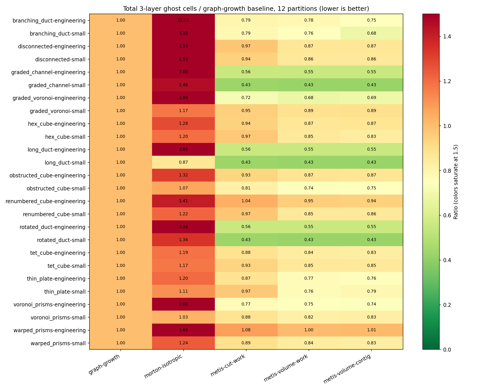

# 通用网格图划分与负载均衡模型：2026-10-07

## 选择结果

选定 `metis-volume-contig`：以单元通信量为目标，同时约束单元数与单元面关联数，
对连通的全局图请求连续分区，再通过边界迁移恢复精确 owned 单元配额。
框架采用固定种子 0、`NCUTS=2`、`MINCONN=1`，单元/面工作量容差分别为 1.001/1.05。
选择种子 0 是因为其最差三层 ghost 退化最小；不按具体算例切换种子或策略。

最终有效比较包含 13 类真实网格拓扑、两种规模、4/12 分区，共 52 组问题。
最终候选矩阵共 572 次：图生长和保持长宽比的 Morton 各 52 次，三个多约束 METIS 候选各 156 次。
每项顺序执行，划分计时排除图生成、读取、Numba 编译、指标计算和绘图。
这是一项划分质量和一次性划分代价研究，不是 PDE 求解速度或 MPI 扩展性测量。

## 最终候选对照

比值以同一图、同一分区数的现有图生长为基线；数值越小，三层 ghost 越少。
“种子中位数”先在每组问题内对三个种子取中位数，再对 52 组比值取几何平均。
“固定种子 0”对应实际框架默认策略。对确定性候选，两列相同。

| 候选 | 种子中位数的几何平均 ghost 比值 | 固定种子 0 的几何平均比值 | 固定种子 0 最差比值 | 所有种子最大面工作量偏差 |
|---|---:|---:|---:|---:|
| metis-volume-contig | 0.7556 | 0.7636 | 1.0030 | 4.01% |
| metis-volume-work | 0.7633 | 0.7644 | 1.0455 | 5.84% |
| metis-cut-work | 0.8067 | 0.8089 | 1.0882 | 3.32% |
| graph-growth | 1.0000 | 1.0000 | 1.0000 | 4.54% |
| morton-isotropic | 1.7241 | 1.7241 | 26.3742 | 1.38% |

默认策略的三层 ghost 几何平均减少 23.6%，最差一组增加约 0.30%。三个种子中位数的
几何平均减少 24.4%，最差单一种子增加约 2.60%。这些是跨网格比值，不能直接换算为求解器加速。
所有连通输入的分区都保持连通，未出现确实切断原分区连接的配额迁移。
不连通输入最多出现每分区 4 个连通块；精确配额与任意图的分区连通性不能同时作普遍保证。
面工作量是 owned 单元面关联数的总和，估计通用装配和几何循环负载；它不等于 FLOPS 或 AMG 各层负载。

## 工程规模：固定种子 0、12 分区

| 网格族 | 单元数 | 原 ghost 总数 | 新 ghost 总数 | ghost 变化 | 割面变化 | 原/新局部面负载倍率 | 划分时间（秒） |
|---|---:|---:|---:|---:|---:|---:|---:|
| branching_duct | 364,832 | 54,472 | 41,115 | -24.52% | -59.63% | 1.088 / 1.067 | 0.808 |
| disconnected | 320,000 | 106,538 | 91,568 | -14.05% | -44.58% | 1.224 / 1.098 | 0.762 |
| graded_channel | 262,144 | 30,564 | 16,902 | -44.70% | -77.18% | 1.133 / 1.006 | 0.441 |
| graded_voronoi | 512,000 | 193,854 | 134,902 | -30.41% | -49.23% | 1.178 / 1.143 | 2.672 |
| hex_cube | 512,000 | 167,189 | 144,124 | -13.80% | -39.33% | 1.109 / 1.088 | 2.554 |
| long_duct | 262,144 | 30,564 | 16,902 | -44.70% | -77.18% | 1.133 / 1.006 | 0.470 |
| obstructed_cube | 460,160 | 130,310 | 113,226 | -13.11% | -44.15% | 1.092 / 1.064 | 1.949 |
| renumbered_cube | 512,000 | 151,322 | 141,142 | -6.73% | -35.89% | 1.102 / 1.058 | 3.961 |
| rotated_duct | 262,144 | 30,564 | 16,902 | -44.70% | -77.18% | 1.133 / 1.006 | 0.455 |
| tet_cube | 511,104 | 113,849 | 93,371 | -17.99% | -35.90% | 1.107 / 1.061 | 1.144 |
| thin_plate | 147,456 | 14,778 | 10,959 | -25.84% | -38.31% | 1.069 / 1.022 | 0.216 |
| voronoi_prisms | 512,000 | 208,736 | 153,334 | -26.54% | -48.37% | 1.187 / 1.106 | 3.277 |
| warped_prisms | 500,094 | 122,975 | 122,846 | -0.10% | -37.60% | 1.091 / 1.072 | 1.955 |

实际求解器主案例使用 500,094 个扭曲三角棱柱。该图的割面从 36,407 减少至 22,717，
但三层 ghost 仅从 122,975 减少至 122,846，约 0.10%。局部面负载倍率从 1.091 改善到 1.072。
因此该算例的内存优化主要还依赖局部网格分发和代数缓冲压缩，实际收益必须另行测量。

## 配额修正实现

修正保留 `N/P + (rank < N%P)` 精确配额，优先采用最小割边代价的边界迁移。
候选放入优先队列；迁移后仅更新该单元及邻居的代价。
用最多展开 64 个节点的局部路径证明移除单元后，其原分区的 owned 邻居仍相互连通。
证明缓存只在相同所有权状态下有效。经过平衡分区路由配额时，每个有向分区邻接只需一个可迁移证明。
没有局部证明时允许必要的配额迁移；Python 使用完整搜索记录其是否确实切断连接。
64 节点预算限制一次性候选筛选代价，没有改变 halo 宽度或离散 stencil。

同一 512,000 单元 Voronoi 图、12 分区、种子 29 的修正时间从 23.694 秒降低到 1.491 秒，
最终所有权 SHA256 相同。完整划分时间从 25.330 秒降低到 3.086 秒。
最终连通候选在全部样本中的最长完整划分时间为 4.333 秒，最长配额修正为 1.623 秒。
这说明实现优化改善了修正开销；单次候选时间仍不是严格的重复性能统计。

## 有效图与独立验证

- 13 类小型原生网格由面环独立重建图，经过框架 `readMeshFile()` 与 `Mesh::validate()` 检查。
- 修正后的普通和加密 Voronoi 完整基底各有 16,000 个多边形。实际面环邻接与 CSR 完全对齐；
  框架检查总域体积均为 1，最小单元体积分别约 `9.24e-7`、`1.52e-8`。32 层挤出产生 512,000 单元工程图。
- 独立 Python deque BFS 核对 1/3 层 halo、完整连通判定和有限预算证明；检查经过平衡中间分区路由及无边图的精确配额。
- C++ 实现与 Python 所选策略在 13 个原生网格、4/12 分区上的所有权逐单元一致，共 26 组。
- 在实际 500,094 单元输入上，通过链接包装捕获 C++ 传给 METIS 的 CSR、两项权重和目标比例。
  邻接与权重全部对齐；修正目标比例的一次性舍入后，METIS 原始所有权和精确配额后的所有权
  都与 Python 逐单元一致，715 次配额迁移没有切断连接。所有权 SHA256 为
  `c989dd364e0462a806dbaf31eb7342acf47ec09b00ff90cc988e30b2010362fc`。
  双精度归一化再转 METIS 实数精度，与本研究全部 52 组参数的目标比例逐位相同。
- 极端 `x^3` Voronoi 旧生成器在 16,000 点规模下使部分点接近镜像边界的 Qhull 容差，
  图与实际面环不一致。旧工程数据排除；采用 `0.002 + 0.996*x^3` 后重新验证并重测两个规模。
  [排除记录](partition-model-2026-10-07-evidence/excluded-graphs.json)保留原因，旧探索记录未删除。

最终汇总复用 `selected-policy` 中 12 个未变网格族、同一算法源码和同一图哈希的记录，
并替换修正后的加密 Voronoi 两种规模。逐记录保留源研究与源文件路径，来源见
[validated-policy/study.json](partition-model-2026-10-07-evidence/validated-policy/study.json)。
[原始记录](partition-model-2026-10-07-evidence/validated-policy/runs/)、
[CSV](partition-model-2026-10-07-evidence/validated-policy/summary.csv)、
[C++ 对照](partition-model-2026-10-07-evidence/cpp-model-fixtures.json)、
[工程规模对照](partition-model-2026-10-07-evidence/cpp-model-engineering-normalized-12.json)、
[完整 Voronoi 基底几何](partition-model-2026-10-07-evidence/voronoi-engineering-base-geometry.jsonl)保留可追溯证据。

工程规模审计还发现，GCC 快速浮点倒数优化会使部分原 C++ 比例相差一个末位，继而改变 METIS 的
划分选择。框架仅对一次性的比例归一化采用普通除法，求解循环的优化标志保持原设置。
[修正前对照](partition-model-2026-10-07-evidence/cpp-model-engineering-12.json)保留差异证据；
该版本的求解性能记录不能作为修正后版本的强扩展数据。

## 方法资料与重现

[METIS 5.1 手册](https://karypis.github.io/glaros/files/sw/metis/manual.pdf)提供多约束、通信量、
`MINCONN` 和 `CONTIG` 的定义。通信量目标只直接对应图的一层通信；本研究另外测量三层 halo。
[Zoltan RCB](https://sandialabs.github.io/Zoltan/ug_html/ug_alg_rcb.html)与
[RIB](https://sandialabs.github.io/Zoltan/ug_html/ug_alg_rib.html)是几何候选的参考；Python 对照没有调用 Zoltan。
最初也比较了 RCB、RIB、逐坐标归一化 Morton 与单约束割边 METIS。它们用于初筛；最终选择依据上面的
通用候选矩阵及最差情况，而不是只选择立方网格表现最好的算法。

运行方式、依赖、指标边界和生成器见 [模型方法说明](../performance/partition-model.md)。
所有任务与实际求解器基准共用排他锁，不同时运行两个测试。
最终求解器的计算速度、强扩展效率、总 RSS 和数值一致性由独立报告给出。
